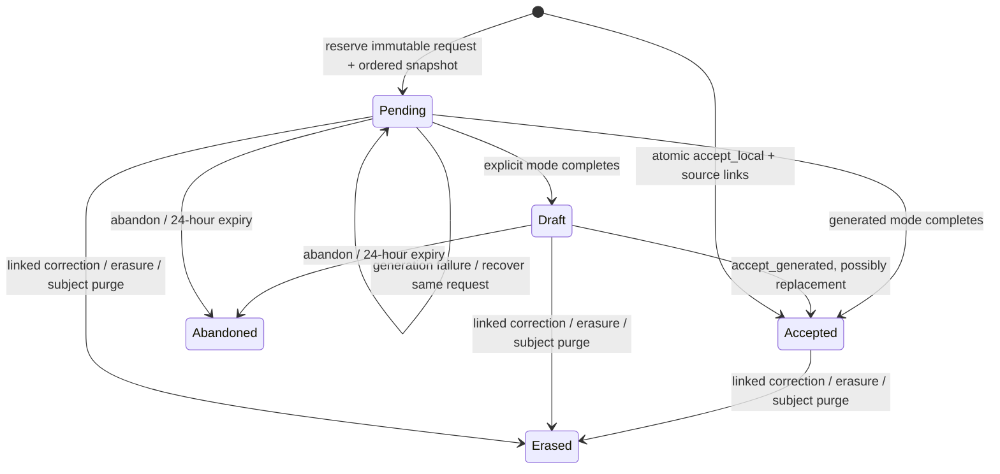

# Managed conversation history

CH3 implements [conversation-history-1](contracts/conversation-history-v1.md) under
[ADR 0007](adr/0007-conversation-history.md). Ordinary Chat Completions still uses
only supplied dialogue. Unextended Responses retains its accepted input/persistence
behavior. Neither path promotes legacy messages/drafts to managed accepted history.

## Configuration and model limits

Apply migrations through **000006** before running this version (managed history
itself was introduced in 000005). `HISTORY_ENABLED=false`
(default) disables new managed generation/local capture and ready capability
advertisement. Existing accepted receipts, generated finalization, abandonment and
erasure remain operable. Re-enabling does not remove fences or revive expired turns.

| Variable | Default | Meaning |
| --- | --- | --- |
| `HISTORY_ENABLED` | `false` | Opt in to new managed capture/replay |
| `HISTORY_RECENT_EXCHANGES` | `8` | Latest accepted whole exchanges, 1–64 |
| `HISTORY_PROMPT_INPUT_TOKENS` | `32768` | Conservative whole-input ceiling |
| `HISTORY_RESERVED_OUTPUT_TOKENS` | `4096` | Output reservation and provider maximum |

The deployment operator chooses ceilings for `OPENAI_CHAT_MODEL`: their sum must
fit that model's context window, and the output reservation must fit its maximum
output. Managed requests accept only the public alias or that configured model.
There is no inferred window for arbitrary provider model IDs. The implementation
counts serialized UTF-8 bytes for the complete provider request plus 128 units of
envelope allowance, deliberately overestimating text tokens. This includes current
instructions/facts, retrieved sections, response schemas and all dialogue. It drops
oldest whole exchanges until the request fits; mandatory oversize returns
`context_budget_exceeded`. Caller output limits may be smaller, never larger than
the reservation. Missing limits become `max_completion_tokens` on the provider call.
Test provider/model support for that option before release.

Managed v1 accepts one current user string and optional current text instructions;
it rejects tools, prior dialogue, multimodal inputs and streaming. The ordinary Chat
path retains CH2 tools and SSE. Managed completion requires a nonblank bounded text
answer with finish reason `stop`; a truncated, filtered or tool result is
`incomplete_generation`, remains pending and never becomes replayable. Instructions
and retrieved current facts are never copied into replayable transcript rows.

## Request lifecycle

Use the contract's session/turn/history/acceptance headers. `off` captures without
replaying; `recent` loads accepted exchanges; [adaptive](adaptive-history.md) is an independent,
explicit opt-in.
Memory and reference-knowledge controls are independent. Generation echoes the
contract/session/turn/snapshot headers and uses a standard response body with a
unique gateway response ID. The complete original JSON body and normalized selectors
are bound with SHA-256 of RFC 8785 JCS bytes. Hashes are internal, never logged.
Credentials and raw prepared instructions are not stored to retain this binding.

Draft is a pending database state with a durable complete result. A session allows
one pending turn; a different managed turn receives `turn_pending`. A simultaneous
request for the active turn receives `turn_in_progress`; if contention occurs before
a reservation is visible, the gateway returns retryable `history_unavailable`.
Other operations retain existing subject serialization. A dedicated PostgreSQL
connection holds the advisory lock and performs managed writes. Its lifetime is
the worker lease: a crash/disconnect releases it, and that worker cannot commit using
a replacement pooled connection. A matching retry can resume a resultless turn;
provider execution may repeat. No exactly-once upstream claim is made.

A reservation pins provider/model/configuration, snapshot sequence, context generation
and accepted turn identities before generation. Adaptive selection is committed once
after classification and before its first generator attempt. Retrying cannot extend the earlier snapshot.
Configuration drift makes resumption unavailable until the original configuration
is restored or the pending turn is abandoned. Credentials can rotate without changing
the binding. A saved matching result returns without another provider call, after
source/fence/snapshot checks. Finalized replacements replay; the original explicit
draft remains only in its result retry copy. Acceptance never asserts delivery.

The 24-hour deadline starts at first reservation. It is checked before provider-result
commit, finalization and each session operation; it never extends on retries.
Expired turns are atomically wiped and retain the same payload-free abandon receipt.
Cleanup is request driven: idle sessions can retain expired bytes until next access;
expired bytes never become eligible. `abandon` remains safe to retry after expiry.
Accepted dialogue/results/hash bindings/receipts have no automatic TTL and remain
subject to linked-session or full-subject erasure. Unicode transcript bytes are
stored losslessly, separately from legacy `messages`; replay does not insert rows.

## Erasure and recovery

All session dependencies are checked even with `history: off` or no new
`knowledge_refs`. Local acceptance atomically links current source revisions and
stores the exchange. Generation reservations atomically link dependencies with the first retained
inbound bytes, before provider access; accepted replacements inherit those dependencies. Applications must validate that
replacements introduce no new unlinked canonical sources.

Linked deletion first commits payload-free session fences with the record fence,
then attempts physical cleanup. A failed cleanup leaves history inaccessible;
retry the same existing linked deletion operation. Correction atomically updates
the source and erases/fences affected sessions, or rolls back the complete correction.
Cleanup cascades turns/results/receipts with legacy session messages/context packets.
Session fences survive physical cleanup and reject delayed calls with `session_deleted`.
Subject purge removes session fences under its permanent subject fence.
[CL1 conversational learning](conversational-learning.md) can separately capture
accepted user reports as simple source-backed observations. It never learns
assistant drafts or vectors of the full transcript. Linked-source erasure also
removes those observations and their vectors; unfinished cleanup fences recall.

## Rollout and rollback

Back up canonical storage and stop existing gateway writers. Apply migrations through 000006,
verify its clean version, and deploy only instances implementing the same fences.
The migration backfills existing link revisions, never accepted dialogue. Confirm
scoped capabilities with the intended model ceilings before consumer enablement.
Oria OCH2–OCH4 implements capability gating, disclosure, durable accepted-turn
work and cross-service verification. These source changes do not activate live
conversation history; use the [CH7 release checklist](conversation-history-release.md).

To roll back capture, set `HISTORY_ENABLED=false` while retaining this implementation
and migration. Existing finalization/abandon/erasure work continues. Do not downgrade
to CH2 or an older image that ignores terminal session fences. The migration's down
script deliberately refuses destructive removal of those fences; a failed attempted
down migration requires the normal operator dirty-version recovery procedure.
Publication, live migration, provider continuity/quality checks and application
rollout are separate CH7/OCH5 work. See [CH3 evidence](evidence/conversation-history-ch3.md).

See the [CH7 release checklist](conversation-history-release.md) for coordinated
versions, independent capture controls, live checks and rollback ordering.

## Decisions observation

Optional [CH4/CH5 observation and cache diagnostics](decisions-observation.md)
are implemented, disabled by default. Recent observation never changes generation. [CH6 adaptive selection](adaptive-history.md)
is implemented as an independent opt-in, with unchanged public schema and no migration.
